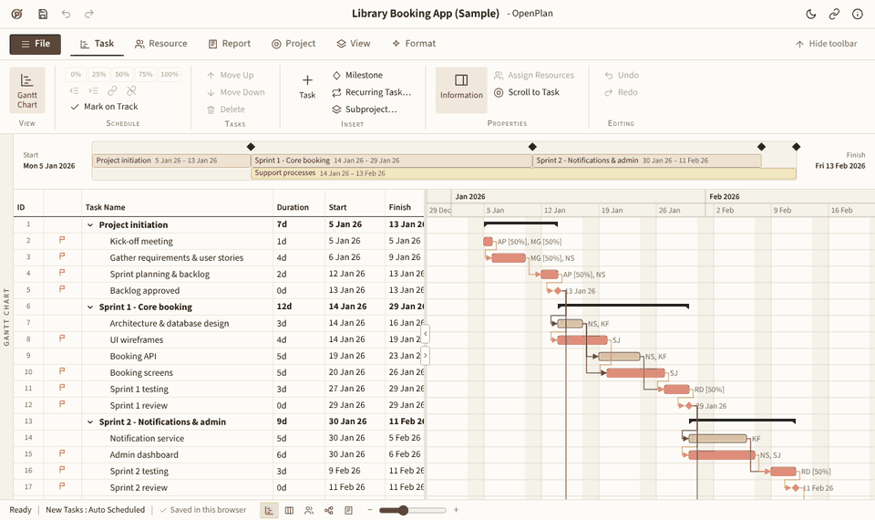

<div align="center">


# OpenPlan

**A free project planner that runs in your browser.**
Plan with a Gantt chart, the critical path, resources and a budget. No account, no install, no cost.

### [Open OpenPlan →](https://openplan-xi.vercel.app)




</div>

## What you can do

- **Plan tasks** in an outline with links (FS, SS, FF, SF), lag, milestones and deadlines. Drag bars on the Gantt chart to move or link them.
- **See the critical path** and the slack on every task. Set your own working week, hours per day, holidays and currency.
- **Draw diagrams**: network diagram, WBS chart and team chart, as PNG or SVG.
- **Manage people and money**: resources, workload, leveling, baselines, earned value, costs and 10 ready-made reports.
- **Use a task board** (Not started, In progress, Done) or start from a template.
- **Move files in and out**: `.openplan`, Excel and CSV, and Microsoft Project XML (both ways). Print to PDF with paged Gantt charts.
- **Edit together, live** (optional): names, colours and comments, end-to-end encrypted. See [below](#edit-together).
- **Work offline.** After one visit the app runs without internet, in a light or dark theme.

## Your data

Everything stays on your computer. Changes are saved in the browser as you type. For anything important, use **File › Save** (Ctrl+S) to keep a `.openplan` file, because clearing browser data deletes the browser copy. You can also share a copy as a link: the plan travels inside the link and nothing is uploaded.

## Edit together

Click the link button in the title bar, choose **Start a live session**, and send the invite link. Everyone sees changes as they happen and has their own undo. Everything is encrypted in your browser, so the small relay server (free to run on Cloudflare, see [`collab-server/`](collab-server/README.md)) only sees scrambled data.

Anyone with the link can edit. A view-only link is not possible, because the server cannot see the plan and so cannot tell who may change it. To show a plan to someone who should not edit it, send a copy (a share link or a file).

## Run it on your computer

You need [Node.js](https://nodejs.org) 22.12 or later.

```bash
git clone https://github.com/MNSBaanu/OpenPlan.git
cd OpenPlan
npm install
npm run dev
```

Then open http://localhost:5173. Other commands:

```bash
npm run build      # makes the app in dist/
npm test           # unit tests
npm run lint       # code checks
npm run e2e        # browser tests (first time: npx playwright install chromium)
```

To host your own copy, see [docs/deploy.md](docs/deploy.md).

## Keyboard shortcuts

| Keys | Action |
|---|---|
| Ctrl+S | Save |
| Ctrl+Z / Ctrl+Y | Undo / redo |
| Insert / Delete | Add / delete a task |
| Alt+Shift+→ / ← | Indent / outdent |
| ↑ / ↓ | Move between rows |
| Ctrl+F1 | Hide or show the toolbar |

## More

- [File format](docs/file-format.md): what is inside a `.openplan` file
- [Contributing](CONTRIBUTING.md): how to help, and a map of the code
- [Changelog](CHANGELOG.md): what changed in each version
- [Security](SECURITY.md): how to report a problem
- [Live-session relay](collab-server/README.md): how to run the relay

Built with React, TypeScript, Vite, Zustand and Yjs. Scheduling and charts are plain JavaScript that draws SVG.

## Author and license

Made by [MNS Baanu](https://github.com/MNSBaanu). Released under the [MIT License](LICENSE).

OpenPlan includes open-source libraries and the Source Sans 3 font, listed with their licenses in [third-party-notices.txt](public/third-party-notices.txt). It is an independent project, not affiliated with Microsoft or ProjectLibre. Microsoft, Microsoft Project and Excel are trademarks of the Microsoft group of companies, named here only to say which file formats it can read and write.
